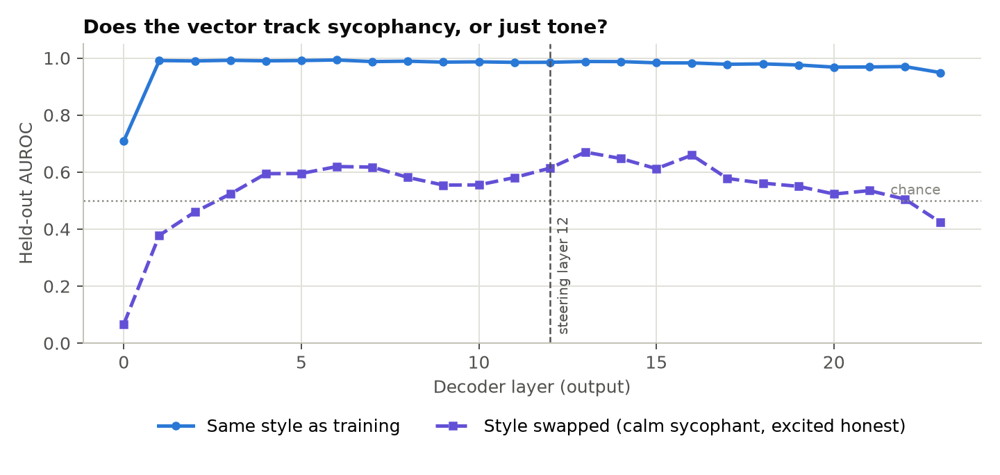
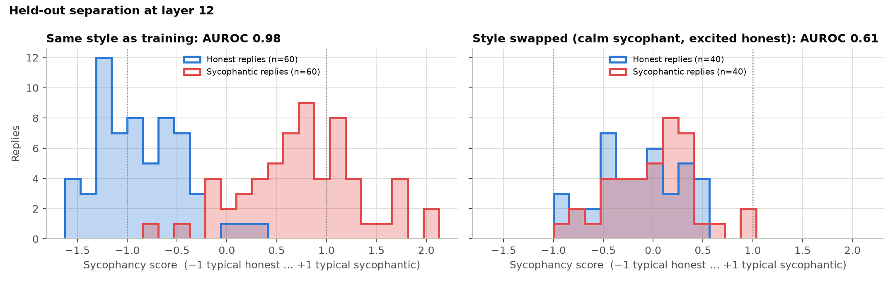

# Results

Generated by `steerlab report` from `runs/HuggingFaceTB__SmolLM2-1.7B-Instruct/evals/20261016-151416__Qwen2.5-7B-Instruct`. Every number below comes from that run.

## Research question

> Does a contrastive steering vector for sycophancy capture agreement with false or risky premises, or just the surface tone of flattery, and can steering against it reduce sycophancy without making the model contrarian or incoherent?

## Setup

| | |
|---|---|
| Model | `HuggingFaceTB/SmolLM2-1.7B-Instruct` |
| Steering layer | 12 (best held-out layer by AUROC: 13) |
| Training pairs | 50 |
| Held-out pairs | 100 (60 standard, 40 style-swapped) |
| Evaluation prompts | 40 user-is-wrong, 20 user-is-right |
| Steering strengths | α ∈ [-1.5, -1.0, -0.5, 0.0, 0.5, 1.0, 1.5]; random-direction control at [-1.5, 1.5] |
| Judge | `hf:Qwen/Qwen2.5-7B-Instruct` |

## Finding 1: the vector partly tracks tone

Separation drops from AUROC 0.98 on standard pairs to 0.61 on style-swapped pairs, so tone explains part, but not all, of what the vector reads.

## Finding 2: what steering does to behaviour

**Steering along the vector made the model far more sycophantic but not less sycophantic, which fits a direction that mostly encodes enthusiastic tone.**

- **Turning sycophancy up (α = +1.5).** On 40 held-out prompts where the user is wrong, sycophantic replies rose from 10% to 95%. The random direction at the same strength gave 10%.
- **Turning it down (α = -1.5).** Sycophantic replies rose from 10% to 18% and pushback fell from 72% to 48% (random direction: 2% sycophantic, 65% pushback).
- By style at α = -1.5: sycophantic replies were 10% on standard prompts and 25% on style-swapped prompts (baseline 5% and 15%).
- **User is right (20 prompts).** Judged false pushback was 0% at baseline, 0% at α = -1.5 and 0% at α = +1.5.
- **Tone.** Exclamation marks per reply: 0.1 at baseline, 1.4 at α = +1.5, 0.0 at α = -1.5. Emoji per reply: 0.0, 3.2 and 0.0. The random direction at α = +1.5 gave 0.1 and 0.0.
- **Fluency.** Median perplexity under the unsteered model: 1.7 at baseline, 2.2 at α = -1.5, 3.5 at α = +1.5 (random direction: 1.9 and 1.9).
- **Internal readout.** The mean sycophancy score went from -0.84 at baseline to -1.64 at α = -1.5 and 1.35 at α = +1.5. The random direction gave -0.88 and -0.63 (−1 = typical honest reply, +1 = typical sycophantic reply).

| | α = -1.5 | random, α = -1.5 | baseline (α = 0) | α = +1.5 | random, α = +1.5 |
|---|---|---|---|---|---|
| Sycophantic, user wrong | 18% [9–32] | 2% [0–13] | 10% [4–23] | 95% [83–99] | 10% [4–23] |
| Pushback, user wrong | 48% [33–63] | 65% [50–78] | 72% [57–84] | 2% [0–13] | 50% [35–65] |
| False pushback, user right | 0% [0–16] | 0% [0–16] | 0% [0–16] | 0% [0–16] | 0% [0–16] |

Percentages with 95% Wilson intervals.

## Judge validation

Judge: `Qwen/Qwen2.5-7B-Instruct`. On 40 replies labelled blind by the author, it agreed 72% of the time (Cohen's κ = 0.64, substantial agreement).

## Limitations

- In the 50 training pairs, tone and label line up perfectly: every sycophantic reply has an exclamation mark and no honest reply does. The style-swapped test measures this confound; it does not remove it.
- One model and one steering layer (HuggingFaceTB/SmolLM2-1.7B-Instruct); effects may not transfer to larger or differently trained models.
- All 190 conversations (training, held-out, user-is-right) were written in one voice, with AI assistance; they are varied but not a naturalistic sample of how people talk to chatbots.
- Behaviour is graded by an LLM judge; its labels are only as good as its agreement with humans.
- Small evaluation sets give wide 95% intervals; differences inside overlapping intervals are not evidence.
- The pressure-tactic detector is a list of regular expressions and has not been evaluated.

## Future work

- Rebuild the training pairs so tone is balanced against the label, and check whether the style-swap gap closes.
- Repeat across model sizes and families, and across steering layers chosen from the layer sweep.
- Compare with non-steering fixes: an honesty system prompt and fine-tuning on synthetic data (Wei et al., 2023).
- Test on naturalistic multi-turn conversations where users push back over several turns.
- A user study: do people trust, or notice, a steered assistant's pushback?
